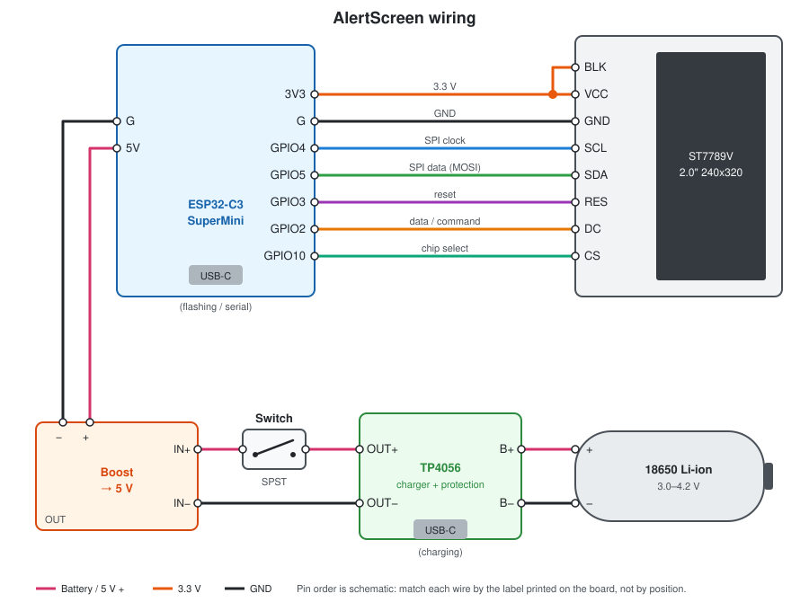

# AlertScreen assembly manual

A battery-powered desk display: an ESP32-C3 SuperMini drives a 2.0" ST7789V screen and refreshes the image over Wi-Fi every 60 seconds. A single 18650 cell powers it, and the cell charges over USB-C.



## 1. Parts

| # | Part | Qty | Notes |
|---|------|-----|-------|
| 1 | 18650 Li-ion cell | 1 | Use a cell with a flat or button top, from a known brand. Solder tabs, or a cell with tabs welded on, are much safer than soldering to the cell body. |
| 2 | TP4056 USB-C charger module | 1 | Use the 6-pad version with protection (pads `IN+ IN- B+ B- OUT+ OUT-`). It has a DW01 chip and an 8205A MOSFET next to the main chip. |
| 3 | Mini DC-DC boost converter, 5 V output | 1 | Must handle at least 1 A input current. If it is adjustable, set it to 5.0 V before you connect anything (step 3). |
| 4 | Rocker switch 10×15 mm, SPST, 2-pin | 1 | Snaps into the cutout in the case top. |
| 5 | ESP32-C3 SuperMini | 1 | |
| 6 | Estardyn 2.0" TFT, ST7789V, 240×320, SPI | 1 | |
| 7 | `case.stl` and `cap.stl` (3D printed) | 1 each | |

**Consumables:** about 1 m of thin silicone wire (26–28 AWG for signals, 22–24 AWG for battery and 5 V), heat-shrink tubing, solder, and Kapton tape or a little hot glue.

**Tools:** a soldering iron, a multimeter, wire strippers, flush cutters, and a computer with PlatformIO installed.

## 2. Safety first

- Li-ion cells can catch fire if they are shorted, reversed or punctured. **Never short `B+` to `B-`**. Insulate every exposed joint with heat-shrink before the next step.
- Do not hold a soldering iron on the cell body. If your cell has no tabs, use a tab-welded cell or an 18650 holder.
- Check polarity with the multimeter before you connect the cell to anything.
- Wire the cell last: build and test the rest from a bench supply or USB first.

## 3. Wiring overview

### Power chain

```
18650 ──► TP4056 (B+/B-) ──► OUT+ ──► switch ──► boost IN+ ──► boost 5V ──► ESP32-C3 5V
                             OUT- ──────────────► boost IN- ──► boost GND ─► ESP32-C3 G
```

| From | To | Wire |
|------|----|------|
| 18650 `+` | TP4056 `B+` | red, 22–24 AWG |
| 18650 `−` | TP4056 `B-` | black, 22–24 AWG |
| TP4056 `OUT+` | switch, pin 1 | red |
| switch, pin 2 | boost `IN+` | red |
| TP4056 `OUT-` | boost `IN-` | black |
| boost `OUT+` (5 V) | ESP32-C3 `5V` | red |
| boost `OUT-` (GND) | ESP32-C3 `G` | black |

Leave the TP4056 `IN+` and `IN-` pads unconnected. They are an alternative input to its USB-C port.

### Display to ESP32-C3

The firmware sets these pins in `include/DisplayConfig.h`. Match the wires by the labels printed on each board, not by pin position.

| Display pin | ESP32-C3 pin | Purpose |
|-------------|--------------|---------|
| `VCC` | `3V3` | 3.3 V supply (**not 5 V**) |
| `GND` | `G` | ground |
| `SCL` | `GPIO4` | SPI clock |
| `SDA` | `GPIO5` | SPI data (MOSI) |
| `RES` / `RST` | `GPIO3` | reset |
| `DC` | `GPIO2` | data/command |
| `CS` | `GPIO10` | chip select |
| `BLK` / `BL` | `3V3` | backlight, always on. Run a short jumper to `VCC` on the display. |

The firmware does not control the backlight. Many modules pull `BLK` high on the board, so it can be left unconnected. If the screen stays dark, wire it to 3.3 V.

On the SuperMini (USB-C at the top, chip facing you), the left row is `5V, G, 3V3, 4, 3, 2, 1, 0`. The right row is `5, 6, 7, 8, 9, 10, 20, 21`. All the display wires except `GPIO5` and `GPIO10` go to the left row. Check against the silkscreen on your board.

## 4. The case

The case prints as two parts. Directions below are given as seen from the front of the screen.

| Part | Size | Features |
|------|------|----------|
| `case.stl` | 72 × 48 × 38.6 mm | Front window of about 52 × 35 mm with slots behind it that hold the display board. The front is tilted back slightly with a sloped chin at the bottom. There is a 14 × 8.4 mm rocker-switch cutout at the **top, rear-left**, and a 17 × 26 mm board pocket under the **top, rear-right**. |
| `cap.stl` | 72 × 48 × 5 mm back lid | Snaps into the back of the case. It has a 9 × 4 mm USB-C opening at the **top-right** (seen from the front; top-left when you look at the back). |

Interior layout:

- **Display:** stands upright behind the front window, glass facing out, held by the side slots.
- **TP4056:** goes in the pocket under the top wall, rear-right, components facing down, with its USB-C port facing the back so it lines up with the opening in the cap. This is the only external port: it **charges the battery**.
- **Switch:** goes through the top cutout, rear-left.
- **18650:** lies across the bottom of the case, behind the chin. The inside is about 67 mm wide and the cell is 65 mm long.
- **ESP32-C3 and boost converter:** go in the space between the display and the cap. Insulate their backs with Kapton tape so they cannot short against the display board or the cell.

The ESP32-C3's own USB-C port is **not** reachable once the case is closed. Flash the firmware before final assembly, or take the cap off to reflash.

**Print settings (suggested):** PLA or PETG, 0.2 mm layers, 3 walls, 20 % infill. Print the case standing on its back opening and the cap flat. Check whether the slot overhangs need supports in your slicer.

## 5. Assembly steps

### Step 1. Print and test-fit
Print both parts. Before you solder anything, dry-fit the display in the front slots, the TP4056 in its pocket, the switch in its cutout and the cell along the bottom. Clean up any tight spots, and check that the TP4056 USB-C port lines up with the hole in the cap.

### Step 2. Flash the firmware
Flash the ESP32-C3 on its own, before wiring, so you know the board works:

```bash
~/.platformio/penv/bin/pio run -t upload
```

Open the serial monitor to confirm it boots:

```bash
~/.platformio/penv/bin/pio device monitor
```

### Step 3. Check the boost converter
Power the boost input from a USB supply or bench supply at 3.7–4.2 V and measure the output. It must read **4.9–5.2 V**. If it is adjustable, turn the trimmer until it does. Never connect a converter whose output you have not measured.

### Step 4. Wire the display
Solder the eight display wires to the ESP32-C3 using the table in section 3. Keep them about 6–8 cm long so you can still open the case. Then power the ESP32-C3 from its USB-C port. The screen should show the Wi-Fi setup instructions.

> If the screen stays white or black: check `VCC` on 3.3 V, `BLK` high, and swapped `SCL`/`SDA` or `DC`/`CS` wires.

### Step 5. Build the power chain (no battery yet)
1. Solder short wires to the TP4056 `OUT+` and `OUT-` pads, and to `B+` and `B-`.
2. Push the switch into the case cutout from outside until it clicks. Solder `OUT+` to one switch pin and a wire from the other pin to boost `IN+`.
3. Solder `OUT-` to boost `IN-`.
4. Solder boost `OUT+` to ESP32-C3 `5V` and boost `OUT-` to `G`.
5. Cover every joint with heat-shrink.

### Step 6. Test without the cell
Plug USB-C into the **TP4056**. With nothing on `B+`/`B-`, most modules still put out a voltage on `OUT+`. Turn the switch on: the ESP32-C3 should boot and the screen should light up. Turn it off: everything should go dark. Unplug USB.

### Step 7. Connect the cell
1. Make sure the switch is **off**.
2. Check the cell voltage (3.0–4.2 V) and polarity with the multimeter.
3. Solder `+` to `B+` and `−` to `B-` (or use a holder). Insulate the joints.
4. Turn the switch on. The device should boot from the battery.

### Step 8. Close the case
1. Seat the display in the front slots.
2. Seat the TP4056 in the top pocket, USB-C facing the back. A drop of hot glue holds it in place.
3. Lay the cell along the bottom and fix it with double-sided foam tape.
4. Tape the ESP32-C3 and the boost converter in the space that is left, away from the cell terminals.
5. Fold the wires in without pinching them, then press the cap in until it snaps.

## 6. First start

1. Turn the switch on. With no Wi-Fi saved, the screen shows setup instructions and the device opens a Wi-Fi network called **`AlertScreen-Setup`**.
2. Connect to it from a phone, pick your Wi-Fi in the portal and enter its password.
3. The device connects and shows the image within a few seconds, then refreshes it every 60 s. The clock appears once the time has synced, and the weather once the location has been looked up.

## 7. Use and charging

- **Charging:** plug USB-C into the port in the cap. The TP4056 LED is red while charging and turns green or blue when the cell is full (at about 4.2 V). It can run while charging.
- **Battery life:** the ESP32-C3 keeps Wi-Fi on all the time, so the device draws roughly 0.6–0.8 W. A 2500–3000 mAh cell lasts about **12–15 hours**. This is a rough estimate, so measure your own build. For permanent use, leave it plugged in.
- **Low battery:** the TP4056 protection cuts the output at about 2.5 V. Recharge before that if you can, because deep discharge shortens cell life.
- **Reflashing:** turn the switch **off**, remove the cap and plug USB-C into the ESP32-C3 itself. Do not power the ESP32-C3 from both the battery and USB at the same time, because many SuperMini boards connect USB 5 V straight to the `5V` pin.

## 8. Troubleshooting

| Symptom | Check |
|---------|-------|
| Nothing happens with the switch on | Cell voltage, TP4056 `OUT+` voltage, switch continuity, boost output (5 V). |
| Boots, then resets when Wi-Fi starts | The boost converter cannot supply the current spikes. Use a stronger converter, or add a 470–1000 µF capacitor across the ESP32-C3 `5V`/`G`. |
| Screen backlight on, but no picture | `SCL`/`SDA`/`DC`/`CS`/`RES` wiring, solder joints on `GPIO4` and `GPIO5`. |
| Screen dark | `VCC` on 3.3 V, `BLK` pulled high. |
| Colors inverted or image mirrored | The panel needs different settings: `TFT_INVERT` and `TFT_ROTATION` in `include/DisplayConfig.h`. |
| Stuck on "connecting" | Wrong Wi-Fi password, or a 5 GHz-only network. The ESP32-C3 supports 2.4 GHz only. |
| Does not charge | Cable or charger, TP4056 LED, the solder joints on `B+`/`B-`. |
